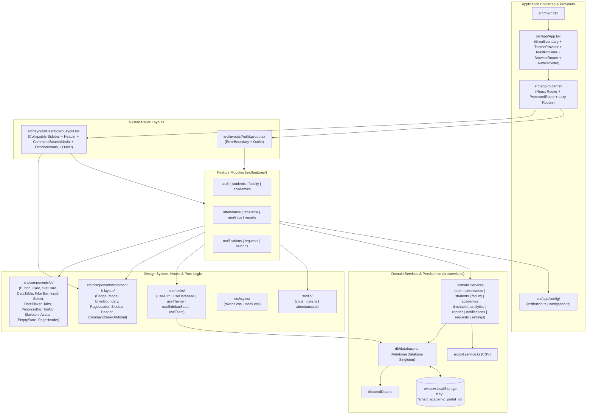

# System Architecture — University Attendance Management System

> **Updated Post-Redesign**: Reflects the modular feature-based React + TypeScript architecture, the CSS-token & Tailwind design system (Light & Dark themes), shared `src/components/ui/` component library, React Router URL navigation, nested layouts, lazy-loaded route chunks, domain service isolation, and `useSyncExternalStore` reactivity.

---

## 1. High-Level Architectural Overview

The application is structured as a **Feature-Based Modular SPA** with clear separation between routing/providers/config (`app/`), shell layouts (`layouts/`), design system primitives (`components/ui/`, `components/common/`, `components/layout/`, `styles/`), domain feature modules (`features/`), reactive hooks (`hooks/`), pure utilities (`lib/`), and the data access layer (`services/`).



---

## 2. Directory Structure (`src/`)

```text
src/
├── main.tsx                                   # React 19 createRoot -> styles/index.css + app/App
├── app/
│   ├── App.tsx                                # Root ErrorBoundary, ThemeProvider, ToastProvider, BrowserRouter, AuthProvider
│   ├── router.tsx                             # URL routes, ProtectedRoute, PublicOnlyRoute, nested layouts, React.lazy
│   ├── providers/
│   │   ├── ThemeProvider.tsx                  # Persistent light/dark theme manager ('academic_portal_theme')
│   │   └── ToastProvider.tsx                  # Accessible toast notification viewport
│   └── config/
│       ├── institution.ts                     # Centralized branding, logo icon, academic defaults, demo presets
│       └── navigation.ts                      # ROUTES, grouped nav config, breadcrumbs, notification link resolver
├── assets/
│   └── portal-logo.svg                        # Institutional portal vector logo asset
├── layouts/
│   ├── DashboardLayout.tsx                    # Authenticated shell: collapsible Sidebar, Header, CommandSearchModal, <Outlet />
│   └── AuthLayout.tsx                         # Public shell for /login
├── components/
│   ├── ui/                                    # Shared SaaS Design System primitives
│   │   ├── Avatar.tsx                         # User avatar with initials fallback
│   │   ├── Button.tsx                         # Semantic button variants, sizes & loading state
│   │   ├── Card.tsx                           # Card primitives & compact StatCard
│   │   ├── DataTable.tsx                      # Sortable, paginated table with sticky header & mobile card layout
│   │   ├── DatePicker.tsx                     # DatePicker & TimeInput controls
│   │   ├── EmptyState.tsx                     # Structured empty state view
│   │   ├── FilterBar.tsx                      # FilterBar container & SearchInput
│   │   ├── Input.tsx                          # Input & Textarea primitives with labels/hints/errors
│   │   ├── PageHeader.tsx                     # Consistent page title, badge, description & action slot
│   │   ├── ProgressBar.tsx                    # Threshold-aware attendance progress bar
│   │   ├── Select.tsx                         # Select & accessible DropdownMenu
│   │   ├── Skeleton.tsx                       # Skeleton & PageSkeleton loaders
│   │   ├── Tabs.tsx                           # Pills & underline tab controls with counts & status dots
│   │   ├── Tooltip.tsx                        # Hover/focus tooltip primitive
│   │   └── index.ts                           # Design system barrel export
│   ├── common/
│   │   ├── Badge.tsx                          # Semantic status badge primitive
│   │   ├── Modal.tsx                          # Accessible dialog container
│   │   ├── ErrorBoundary.tsx                  # Reusable React error boundary
│   │   └── PageLoader.tsx                     # Suspense fallback skeleton
│   ├── feedback/
│   │   ├── UnauthorizedPage.tsx               # 403 Unauthorized role access page
│   │   └── NotFoundPage.tsx                   # 404 Not Found page
│   └── layout/
│       ├── Header.tsx                         # Top bar: breadcrumbs, contextual search, theme toggle, notifications, profile menu
│       ├── Sidebar.tsx                        # Collapsible grouped desktop sidebar & mobile drawer
│       └── CommandSearchModal.tsx             # Ctrl+K / Cmd+K search across pages, courses, students & faculty
├── features/
│   ├── academics/pages/                       # AdminSchemesPage, AdminAcademicsPage, AdminSubjectsPage
│   ├── analytics/                             # AttendanceTrendChart, DepartmentBarChart, StatusPieChart, AdminOverviewPage, TeacherLowAttendancePage
│   ├── attendance/                            # AttendanceRosterTable, SessionRosterModal, QuickAttendanceModal, 4 role pages
│   ├── auth/                                  # AuthContext.tsx, LoginPage.tsx
│   ├── faculty/pages/                         # AdminTeachersPage, TeacherOverviewPage
│   ├── notifications/pages/                   # StudentNotificationsPage
│   ├── reports/pages/                         # AdminReportsPage, TeacherReportsPage
│   ├── requests/pages/                        # TeacherCorrectionsPage, StudentCorrectionPage
│   ├── settings/pages/                        # AdminSettingsPage, AdminAuditLogsPage
│   ├── students/pages/                        # AdminStudentsPage, StudentOverviewPage
│   └── timetable/                             # RescheduleSlotModal, AdminTimetablePage, TeacherTimetablePage, StudentTimetablePage
├── hooks/
│   ├── useAuth.ts                             # AuthContext consumer hook
│   ├── useDatabase.ts                         # useSyncExternalStore hook subscribed to database version changes
│   ├── useSidebarState.ts                     # Persistent desktop sidebar collapse & mobile drawer state
│   ├── useTheme.ts                            # ThemeContext consumer hook
│   └── useToast.ts                            # ToastContext consumer hook
├── lib/
│   ├── attendance.ts                          # Pure attendance summary, deficit & buffer math helpers
│   ├── cn.ts                                  # clsx + tailwind-merge utility
│   └── date.ts                                # DAY_NAMES, PERIOD_SLOTS, PERIOD_TIME_MAP, date helpers
├── services/                                  # RelationalDatabase singleton, seedData & 12 domain services
├── styles/
│   ├── tokens.css                             # Light (:root) & Dark (.dark) CSS custom properties & chart tokens
│   └── index.css                              # Typography, focus-visible rings, reduced-motion & print rules
└── types/                                     # Modular domain & view-model TypeScript interfaces
```

---

## 3. Enterprise Design System & Dual-Tier Navigation

- **Design Tokens ([tokens.css](file:///c:/Users/USER/Documents/Ai-proj/src/styles/tokens.css) & [tailwind.config.js](file:///c:/Users/USER/Documents/Ai-proj/tailwind.config.js))**:
  - **Dual-tier sidebar palette**: Primary icon rail `#2828D6` (`bg-nav-rail`, `64px`), contextual secondary sidebar `#3939E7` (`bg-nav-panel`, `232px`), active item `#5656EB` (`bg-nav-active`), white text `#FFFFFF`, muted sidebar labels `#C7C7FF`.
  - **Workspace palette (Light-only)**: Main workspace `#FFFFFF`, secondary surface `#F9FAFB`, primary text `#171923`, secondary text `#6B7280`, borders `#E5E7EB`, and restrained semantic green/amber/red outlined badges exclusively for attendance statuses, warnings, and errors.
  - **Typography**: `Inter` across the entire application (`22px` semibold page titles, `16px` section headers, `14px` navigation/body, `13px` table rows, `12px` supporting labels, `tabular-nums` for numeric columns).
- **Dual-Tier Role Navigation ([navigation.ts](file:///c:/Users/USER/Documents/Ai-proj/src/app/config/navigation.ts), [Sidebar.tsx](file:///c:/Users/USER/Documents/Ai-proj/src/components/layout/Sidebar.tsx), [Header.tsx](file:///c:/Users/USER/Documents/Ai-proj/src/components/layout/Header.tsx))**:
  - Primary rail icons switch the contextual secondary sidebar per role (**Admin**: 7 modules; **Faculty**: 6 modules; **Student**: 5 modules) with tooltips, translucent sidebar search, collapsible groups, and persistent collapse preference (`academic_portal_sidebar_collapsed`).
  - Minimal `56px` white top header with breadcrumbs, notifications popover, profile/account switcher, and mobile drawer toggle.
- **Enterprise Tables & Responsive Behaviour**:
  - `DataTable` provides white surfaces, thin `#E5E7EB` borders, row selection checkboxes (`selectable`), column sorting, pagination, and mobile card views (`< md`).
  - Desktop (`lg+`) shows both sidebar tiers; tablet (`md`) retains the primary icon rail with collapsible secondary panel; mobile (`< md`) switches to an accessible slide-over drawer.

---

## 4. State Management & Persistence

- **Zero Direct DB Access in UI**: All feature pages, modals, and layout components communicate strictly through `src/services/*.service.ts`.
- **Reactive Store Subscription**: `useDatabaseVersion()` uses `React.useSyncExternalStore` backed by `db.getVersion()`, ensuring all mutations re-render subscribed Admin, Faculty, and Student views immediately.
- **Preserved Storage Keys**:
  - `smart_academic_portal_v6`: Institutional relational state
  - `smart_attendance_auth_user_id`: Active authenticated user session
  - `academic_portal_theme`: Persistent Light/Dark theme preference
  - `academic_portal_sidebar_collapsed`: Persistent desktop sidebar collapse preference
