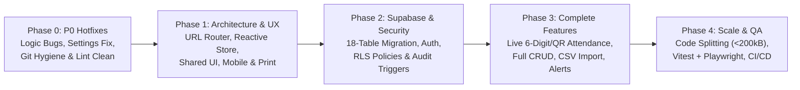

# Prioritized Development Roadmap — University Attendance Management System

This roadmap translates the findings from `docs/PROJECT_AUDIT.md` and `docs/ARCHITECTURE.md` into an actionable, sequenced engineering plan. Every item is grounded in verified code inspection and ordered by **risk reduction**, **data correctness**, and **product completeness**.

---

## Roadmap Overview

---

## Phase 0: Immediate Hotfixes, Data Accuracy & Code Hygiene (Priority: P0 — Critical)

**Objective**: Fix broken forms, inaccurate attendance math, silent UI non-updates, and repository safety issues **before** architectural refactoring.

### 0.1 Repository & Secret Safety
- [ ] **Fix `.gitignore`**: Add `.env`, `.env.*`, and `!.env.example` to `.gitignore` so Supabase credentials cannot be accidentally committed.
- [ ] **Remove Dead Scaffold Assets**: Delete unused `src/App.css`, `src/assets/hero.png`, `src/assets/react.svg`, `src/assets/vite.svg`, `public/icons.svg`, and unused packages (`clsx`, `tailwind-merge`—or adopt a shared `cn()` helper).

### 0.2 Fix Broken Forms & Unrouted Views
- [ ] **Unblock `AdminSettingsPage.tsx`**: Separate `code_duration_minutes_default` (`min=1, max=60`, default `10`) from lecture duration, and add the missing UI toggle for `leave_counts_as_present`.
- [ ] **Wire `AdminActivitiesPage.tsx`**: Import `AdminActivitiesPage` in `src/App.tsx` (`admin-activities`) and add `"Academic Activities"` to `adminNav` in `Sidebar.tsx`.
- [ ] **Fix `AdminAcademicsPage.tsx` Invalid Foreign Keys**: Replace hardcoded `'prog-be-cse'` with dynamic programme lookup (`programmes.find(p => p.department_id === deptId)?.id`) and delegate Subject creation to the shared subject form modal.

### 0.3 Fix Core Attendance & Timetable Logic Bugs (`database.ts` & Pages)
- [ ] **Fix Subject-Wise Student Attendance Filter (`database.ts:1401`)**: Filter `eligibleSubjects` by `s.department_id === student.department_id` (and/or subjects scheduled in `timetable` for `student.class_id`) so CSE students no longer see Civil, Mechanical, Electrical, ECE, and AIML subjects.
- [ ] **Unify Unrecorded Session Semantics (`database.ts:1372`)**: Count all conducted `relevantSessions` for the student's class (or display `'Not Marked'` / `'N/A'` when `totalSessions === 0` rather than `100%`), reconciling `calculateStudentAttendance` with `StudentHistoryPage` and `StudentOverviewPage`.
- [ ] **Fix `getLowAttendanceStudents()` Filter (`database.ts:1420-1446`)**:
  - Filter strictly on `overallPercentage < cutoff` (with `totalClasses > 0`) for the `"Below Threshold"` list.
  - Compute `declining` accurately from the student's **last $k$ chronological session records** (2+ consecutive absences) rather than lifetime `absent >= 2`.
- [ ] **Eliminate Fabricated Chart Numbers (`database.ts:1480-1521`)**:
  - Remove hardcoded `88.5%` (`18/20`) fallback on zero-session days in `getAttendanceTrend()`; plot `null` / `0` sessions honestly and add a `teacherId` filter for `TeacherOverviewPage`.
  - Remove `.slice(0, 6)` and fake `85.0%` fallback in `getDepartmentStats()` so all 11 departments render accurately.
- [ ] **Support Multi-Period Same-Day Sessions**: Include `start_time` and `timetable_entry_id` when looking up and creating sessions in `QuickAttendanceModal` and `TeacherMarkAttendancePage`; pass the selected slot's target date from `TeacherTimetablePage`.
- [ ] **Unify Timetable Conflict & Period 7 Handling**:
  - Use `checkTimetableConflict()` (all 3 checks + `academic_year`) inside `createTimetableEntry()`.
  - Add Period 7 (`16:00 - 17:00`) and 24-hour `HH:mm` times to `AdminTimetablePage.tsx`.
- [ ] **Local Timezone Date Helper**: Replace all 11 `new Date().toISOString().split('T')[0]` calls with a timezone-safe local `getLocalDateISO()` utility.

### 0.4 Fix State Reactivity & Dynamic Persona Headers
- [ ] **Fix Admin UI Reactivity**: Replace the `AuthContext`-only subscription bottleneck with a lightweight `useDatabase()` hook (`React.useSyncExternalStore`) so `AdminTimetablePage` slot deletions and `Header` notification updates re-render immediately across all roles.
- [ ] **Replace Hardcoded User/Dept Strings**: Bind `AdminOverviewPage`, `TeacherOverviewPage`, `StudentOverviewPage`, and `Header.tsx` switcher subtitles dynamically to `currentUser`, `currentTeacher`, `currentStudent`, and `settings`.
- [ ] **Fix Notification Deep Links in `Header.tsx`**: Handle `/student/corrections` -> `student-correction` and `/admin/timetable` -> `admin-timetable`.
- [ ] **Zero-Warning Lint Gate**: Resolve all 167 `oxlint` warnings (remove 149 unused imports/variables, fix 9 impure `Date` calls, fix 5 synchronous effect `setState`s, fix 3 hook dependency arrays, extract `useAuth` hook file) and enable `"strict": true`, `"noUnusedLocals": true` in `tsconfig.app.json`.

---

## Phase 1: Routing, Component Consolidation, Mobile & Print UX (Priority: P1 — High)

**Objective**: Upgrade frontend architecture for maintainability, bookmarkable URLs, mobile usability, and clean printable reports.

### 1.1 URL-Based Routing (`react-router-dom`)
- [ ] Introduce `react-router-dom` with semantic institutional routes:
  - `/login`
  - `/admin/*` (`/admin/overview`, `/admin/schemes`, `/admin/academics`, `/admin/subjects`, `/admin/timetable`, `/admin/students`, `/admin/teachers`, `/admin/activities`, `/admin/attendance`, `/admin/reports`, `/admin/settings`, `/admin/audit`)
  - `/teacher/*` (`/teacher/overview`, `/teacher/timetable`, `/teacher/mark`, `/teacher/history`, `/teacher/low-attendance`, `/teacher/corrections`, `/teacher/reports`)
  - `/student/*` (`/student/overview`, `/student/timetable`, `/student/history`, `/student/corrections`, `/student/notifications`)
- [ ] Support URL query parameters (e.g., clicking `"Request Correction"` on `StudentHistoryPage` navigates to `/student/corrections?sessionId=sess-amcec-3` and pre-populates the exact session, date, and subject).

### 1.2 Shared Component Extraction
- [ ] Extract `<AttendanceRosterTable />` shared by `QuickAttendanceModal` and `TeacherMarkAttendancePage`.
- [ ] Extract `<SessionRosterModal />` shared by `AdminAttendanceMasterPage` and `TeacherHistoryPage`.
- [ ] Extract `<PortalHeroBanner />` shared across Admin, Faculty, and Student overview pages.
- [ ] Replace all 23 invalid Tailwind v3 `shadow-xs` classes with `shadow-sm` and `py-0.2` with `py-0.5`.
- [ ] Add initials-based `<Avatar />` fallback component so broken/offline Unsplash URLs degrade gracefully.

### 1.3 Mobile Responsiveness, Accessibility & Print Fixes
- [ ] Wrap tables in `TeacherMarkAttendancePage` and `AdminAcademicsPage` with `overflow-x-auto` and add mobile card-row layout option for attendance marking on phones.
- [ ] Make `AdminTimetablePage` delete/edit slot buttons visible on touch devices (`opacity-100 lg:opacity-0 lg:group-hover:opacity-100`).
- [ ] Fix `@media print`: Add `no-print` to `Sidebar` and `Header`, and override `h-screen overflow-hidden` on the app shell during print (`print:h-auto print:overflow-visible`) so multi-page reports print cleanly.
- [ ] Upgrade `Modal.tsx` with `role="dialog"`, `aria-modal="true"`, `aria-labelledby`, focus restoration, and Tab focus trapping.

---

## Phase 2: Supabase Backend & Security Hardening (Priority: P1 — High)

**Objective**: Replace insecure client-side-only auth and `localStorage` persistence with a dual-mode Repository Layer supporting real **Supabase Auth + PostgreSQL + RLS** in production while retaining an explicit, gated `VITE_DEMO_MODE=true` sandbox for portfolio demos.

### 2.1 Complete PostgreSQL Schema Migration (`supabase/migrations/`)
- [ ] Expand `supabase/schema.sql` from 13 to all **18 tables**:
  - Add `vtu_schemes`, `programmes`, `timetable`, `timetable_change_logs`, and `academic_activities`.
  - Add all missing VTU columns (`usn`, `vtu_scheme_id`, `programme_id`, `section`, `admission_batch`, `category`, `course_type`, `cie_marks`, `see_marks`, `teaching_hours`, `timetable_entry_id`, `leave_counts_as_present`, etc.).
- [ ] Create PostgreSQL RPC functions (`mark_attendance_batch`, `reschedule_timetable_slot`, `review_correction_request`, `submit_attendance_code`) for atomic server-side transactions and automatic `audit_logs` insertion via triggers.

### 2.2 Authentication & Authorization Hardening
- [ ] **Fix Cold-Load Auto-Admin Login**: Require explicit authentication at `/login`; never auto-login as `admin` when unauthenticated.
- [ ] Integrate **Supabase Auth** (`supabase.auth.signInWithPassword`, session refresh, password reset).
- [ ] Gate Demo Persona Switchers (`Header`, `Sidebar`, `LoginPage`) and `Reset Data` strictly behind `import.meta.env.VITE_DEMO_MODE === 'true'` so they never ship in institutional production deployments.
- [ ] Remove universal `'password123'` backdoor, plaintext `password_hash` storage, and email prefix matching (`admin@...`).

### 2.3 PostgreSQL Row-Level Security (RLS)
- [ ] Enable RLS (`ALTER TABLE ... ENABLE ROW LEVEL SECURITY`) on all 18 tables:
  - **Admin**: Full institutional read/write scoped to institution.
  - **Teacher**: Read curriculum/students; insert/update `attendance_sessions` and `attendance_records` **only** for `(class_id, subject_id)` pairs in their `teacher_assignments`; review `correction_requests` only for their assigned class+subject.
  - **Student**: Read own profile, own class `timetable` & `attendance_sessions`, own `attendance_records`, own `notifications`; insert `correction_requests` only for `student_id = auth_student_id()` and valid conducted `session_id`.
  - **Audit Logs**: Append-only via `SECURITY DEFINER` triggers; read-only for `admin`, zero `UPDATE`/`DELETE` privileges for any role.

---

## Phase 3: Feature Completion & Domain Enhancements (Priority: P2 — Medium)

**Objective**: Deliver the incomplete/missing product features promised in `README.md` and required by university operations.

### 3.1 Smart Proxy Attendance Prevention (End-to-End UI + Realtime)
- [ ] **Teacher Live Code & QR Generator**: Add `"Generate Live Check-In Code"` in `QuickAttendanceModal` and `TeacherMarkAttendancePage` using existing `AttendanceSession.code`, `code_expires_at`, and `endSessionCode()`, complete with configurable timer (`5 / 10 / 15 min`), countdown ring, rotating QR / 6-digit code display, and live check-in feed (via Supabase Realtime or `storage` event in demo mode).
- [ ] **Student Live Check-In Widget**: Add 6-digit code input card on `StudentOverviewPage` and `StudentTimetablePage` wired to `submitAttendanceCode()` with duplicate/expiry/class-enrollment validation.

### 3.2 Complete Admin CRUD & Bulk Operations
- [ ] Add **Edit**, **Deactivate/Archive**, and **Delete** (with referential integrity checks) for Schemes, Departments, Classes, Subjects, Students, and Teachers.
- [ ] Wire up **Unassign Course** (`Trash2` action) on `AdminTeachersPage`.
- [ ] Add **Bulk CSV Import** for Student Enrollment and Subject Catalogue, plus real PDF attachment storage (Supabase Storage) for Scheme Syllabi (replacing the fake `alert()` in `AdminSchemesPage`).
- [ ] Implement the missing `'daily'` Attendance Summary report in `AdminReportsPage` and sanitize CSV exports against formula injection (`=`, `+`, `-`, `@`).

### 3.3 Dispute & Automated Alert Workflows
- [ ] Restrict `StudentCorrectionPage` to select from actual conducted sessions where the student was marked `'absent'` or `'leave'` (eliminating `session-dummy-*` IDs), prevent duplicate pending disputes per session, and support medical certificate / document upload.
- [ ] Implement `auto_alerts_enabled`: Automatically dispatch shortage notifications when `markAttendanceBatch()` causes a student's overall or subject attendance to cross `< 80%` (Warning) or `< 75%` (Critical), and integrate optional email webhook (Resend / Supabase Edge Function) for guardian advisories.

---

## Phase 4: Performance, Automated Testing & CI/CD (Priority: P3 — Polish & Scale)

**Objective**: Ensure fast load times on low-bandwidth campus networks and prevent regressions.

- [ ] **Code Splitting & Bundle Optimization**:
  - Lazy-load Admin, Teacher, and Student route bundles via `React.lazy()` + `<Suspense>`.
  - Split `recharts` into an async analytics chunk and move `seedData.ts` behind dynamic import (loaded only in Demo Mode / initial seed), reducing the initial JS bundle from **`1,051 kB` -> `< 200 kB`**.
- [ ] **Automated Test Pyramid**:
  - Install `vitest` + `@testing-library/react` for unit/integration tests covering `calculateStudentAttendance`, deficit/buffer math, `checkTimetableConflict`, CSV escaping, and `verify-e2e.ts` scenarios.
  - Add Playwright E2E smoke tests covering Login -> Teacher Mark Attendance -> Student View & Dispute -> Teacher Approve -> Admin Audit & CSV Export.
- [ ] **CI/CD Quality Gate (`.github/workflows/ci.yml`)**:
  - Run `tsc -b`, `oxlint --deny-warnings`, `vitest run`, and `vite build` on every pull request.

---

## Summary Priority Matrix

| Phase | Priority | Effort Estimate | Key Risk Mitigated |
| :--- | :---: | :---: | :--- |
| **Phase 0: Hotfixes & Logic Accuracy** | **P0** | 2–3 days | Wrong student subjects/attendance %, broken Settings form, silent Admin UI non-updates, `.env` leak risk |
| **Phase 1: Router, Shared UI, Mobile & Print** | **P1** | 3–4 days | Broken Back button/deep links, duplicated roster modals, mobile table overflow, broken print reports |
| **Phase 2: Supabase Backend, Auth & RLS** | **P1** | 5–7 days | Critical auth bypasses, client-side data tampering, disconnected `supabaseClient` & outdated `schema.sql` |
| **Phase 3: Proxy Codes, Full CRUD & Alerts** | **P2** | 5–6 days | Missing `README` features (6-digit code UI), create-only admin directories, dummy correction sessions |
| **Phase 4: Code Splitting, Testing & CI/CD** | **P3** | 2–3 days | 1.05 MB initial bundle on mobile networks, broken `verify-e2e.ts`, regression risk |
